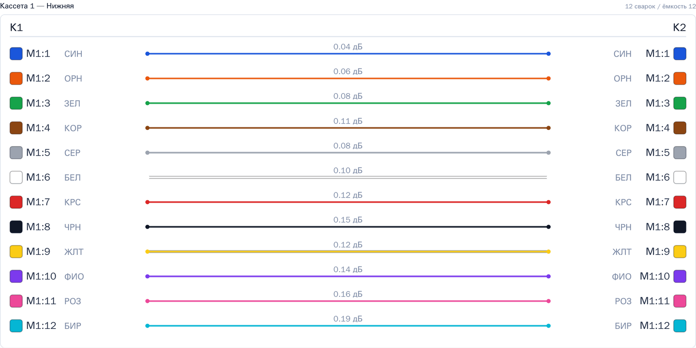
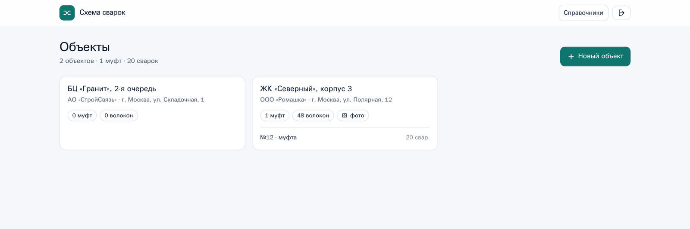
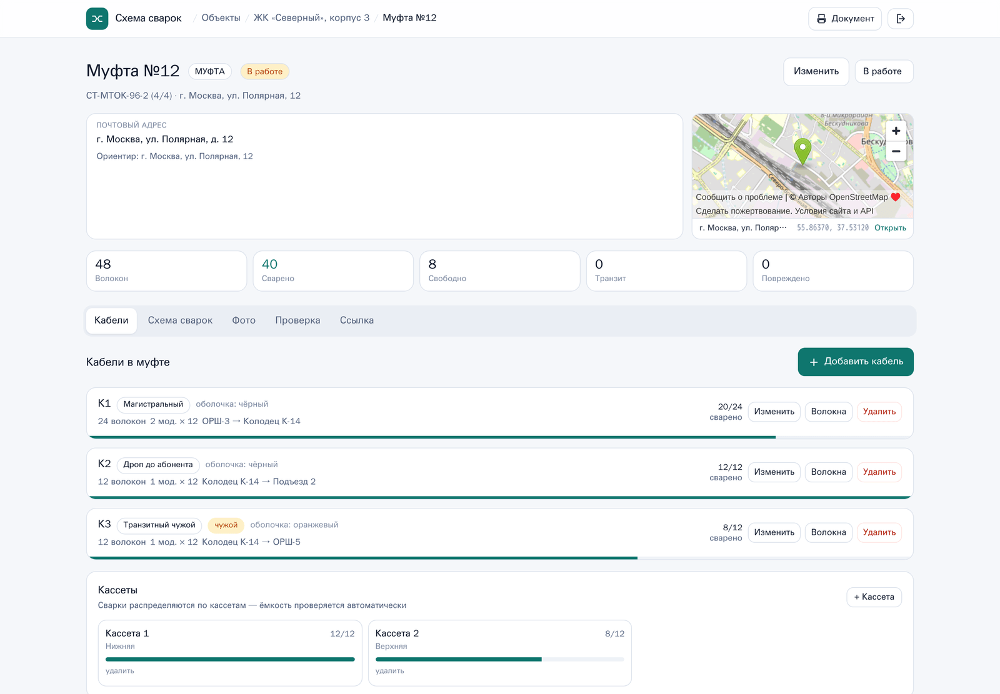
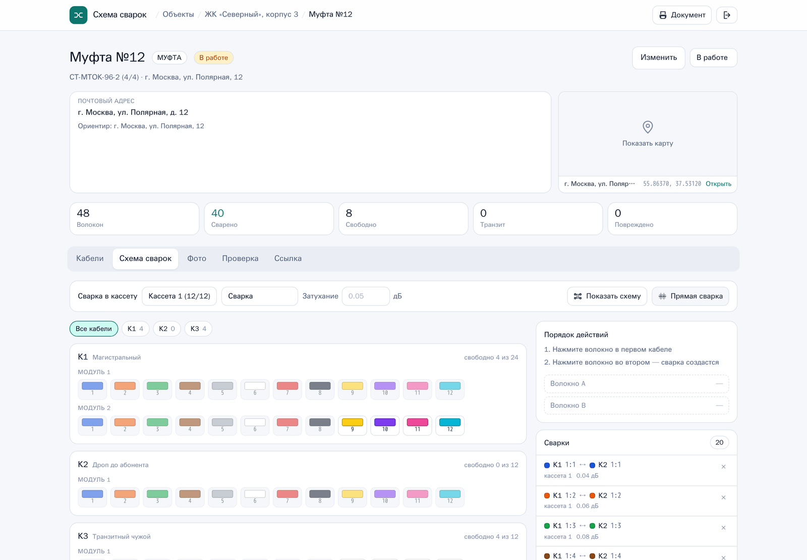
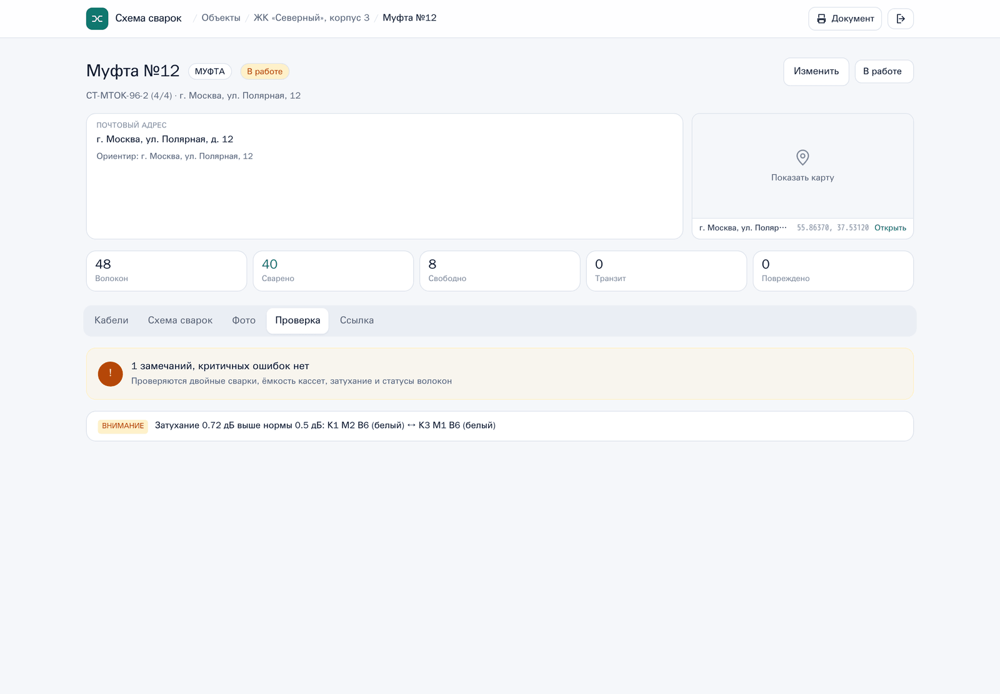
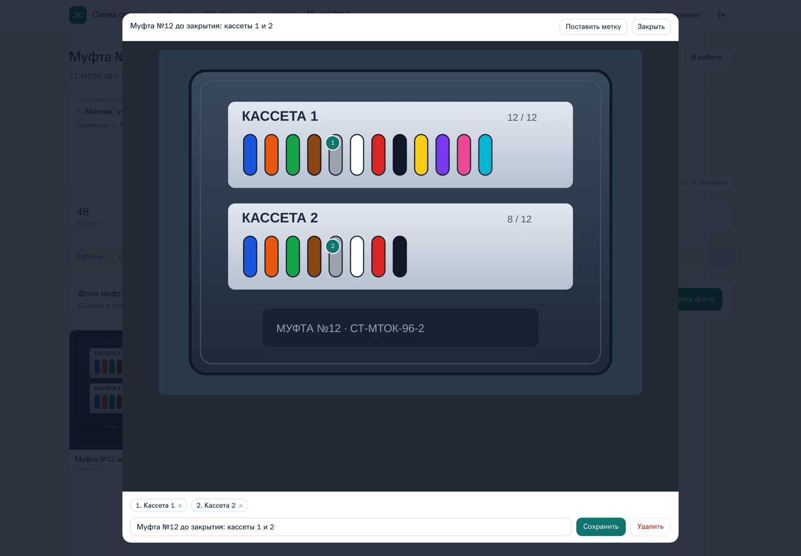
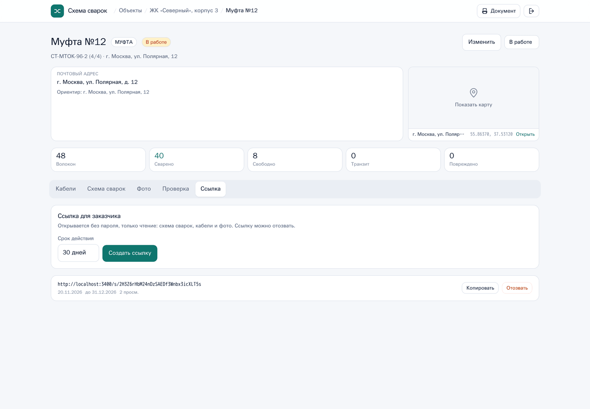
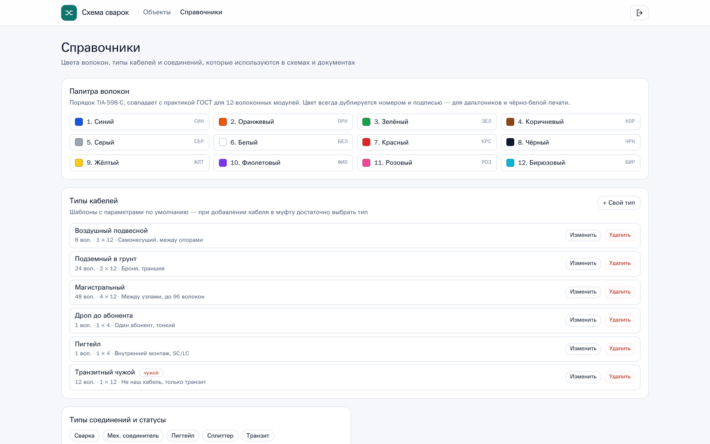
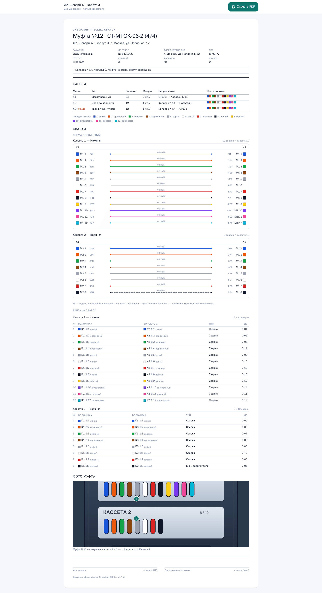
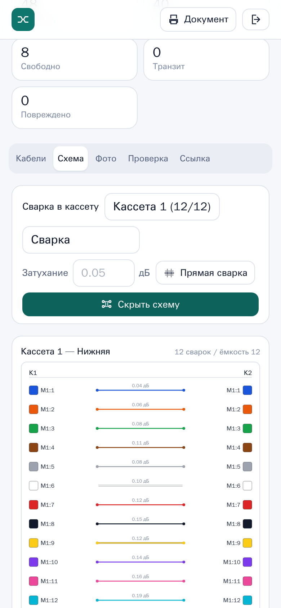

<div align="center">

# 🔌 Схема сварок

**Учёт оптических сварок в муфтах: схема, фото и документ для заказчика**

Сварщик вносит кабели и волокна, собирает схему в два касания, прикладывает фото
муфты — и отдаёт заказчику печатный документ, PDF или ссылку только для чтения.

[](https://github.com/yolo-spolo/fiber-splice-scheme/actions/workflows/ci.yml)
[](LICENSE)
[](https://nextjs.org)
[](https://www.postgresql.org)

</div>



---

## 📖 Содержание

- [Возможности](#-возможности)
- [Как это работает](#-как-это-работает)
- [Скриншоты](#-скриншоты)
- [Установка](#-установка)
- [Деплой](#-деплой)
- [Проверки](#-проверки)
- [Структура](#-структура)
- [Модель данных](#-модель-данных-два-решения-которые-важно-не-менять)
- [Безопасность](#-безопасность)
- [Что дальше](#-что-дальше)
- [Лицензия](#-лицензия)

## ✨ Возможности

### 📐 Схема и данные

- **Объекты → муфты → кабели → волокна.** Волокна генерируются по ёмкости кабеля,
  цвета — по TIA-598 (12 цветов), с модулями по 1/2/4/6/8/10/12/16 волокон.
- **Редактор сварок в два касания:** выбрали волокно в одном кабеле, затем во втором —
  сварка создана. Есть прямая автосварка, undo, привязка к кассете, тип соединения
  и затухание.
- **Кассеты** с контролем ёмкости: переполнение видно сразу.
- **Кабель знает соседей:** поля «Откуда» и «Куда» подсказывают муфты этого объекта
  по адресам, а если нужной нет — принимают произвольный адрес текстом.
- **Валидатор:** двойные сварки, дубли адресов, переполнение кассеты, превышение
  затухания, статусы без сварки.

### 🎨 Цвета и раскладка

- **Цветовка жил:** TIA-598/ГОСТ, DIN/VDE, «все белые» или свой порядок цветов
  с редактором по каждой жиле.
- **Цвета модулей (трубок):** по умолчанию по стандарту — первый синий, второй
  оранжевый. Любой модуль можно перекрасить вручную, «Авто» возвращает к схеме.
  Цвет трубки виден при сварке, в карточке кабеля, в схеме соединений и в документе.
- **Вторая дюжина «с полосой» (13–24)** — чтобы различать волокна в 24-волоконных модулях.
- **Шаблоны кабеля одним тапом:** 1, 2, 4, 8, «2 × 8», «4 × 4», «6 × 8» и
  переключатель ГОСТ / Европа. Количество волокон и модулей вводится свободно,
  пустое поле больше не превращается в 1.
- **Ёмкость модуля считается сама** из числа волокон и модулей: 24 волокна
  в 2 модулях — по 12, 16 в 2 — по 8. Вводить её вручную не нужно.
- **Предпросмотр раскладки до сохранения:** заполнение каждого модуля, остаток
  и количество свободных позиций. Ошибка «не помещается» показывается до сохранения
  и предлагает исправить раскладку автоматически.
- **Смена цвета жилы при сварке:** тап по волокну → «Изменить цвет жилы». Работает
  и для уже сваренного волокна.

### 📄 Документ и передача заказчику

- **Документ A4:** титул, легенда кабелей, таблицы сварок по кассетам, фото с метками,
  схема соединений, подписи сторон, QR на онлайн-схему. Печать и «Сохранить как PDF»
  из одного шаблона. Вёрстка плотная: разделы идут потоком, лист заполняется
  содержимым, а не одной таблицей.
- **Вся папка объекта одним файлом:** кнопка «Документ объекта» собирает титул с
  составом и документы всех муфт подряд, каждая с нового листа. Легенда цветовки
  (TIA-598 / ГОСТ и DIN/VDE рядом) печатается один раз на титуле, подписи сторон —
  один раз в конце папки.
- **Публичная ссылка** на весь объект или на одну муфту: токен, срок действия,
  отзыв и счётчик просмотров. Ссылка на объект открывает список его муфт, каждая
  ведёт на свою схему; файлы по токену отдаются только для муфт этой ссылки.
- **Ссылка с правом правки.** Гость по ней меняет кабели, сварки, кассеты, фото
  и параметры муфты без пароля, но обязан указать имя — оно подписывает каждое
  изменение. Удаление муфты, новые муфты и реквизиты объекта остаются у владельца.
- **История изменений муфты.** Кто, что и когда: значение до и после, отдельно
  для владельца и для гостя по ссылке. Владелец возвращает поле одной кнопкой;
  последние записи печатаются в документе.
- **Подписи волокон.** У волокна есть подпись — «Абонент: кв. 42, Петров»: видна
  на чипе в редакторе сварок и печатается под номером волокна в документе.
- **Трасса волокна.** Вкладка «Трасса» строит маршрут жилы через все муфты
  объекта: где сварка, с каким волокном соединено, с какими потерями и где
  маршрут кончается. Ищут по подписи волокна — «Абонент 14» — и сразу видят
  весь путь до обоих концов, а не открывают муфты по очереди.

### 📷 Фото и адрес

- **Фото муфты:** загрузка с камеры телефона, сжатие на сервере, подписи и метки-пины
  на кассетах.
- **Адрес и карта:** у муфты один адрес — почтовый; он же её имя в списках и
  документах, поэтому муфту узнают по адресу, а не по номеру. Координаты вводятся
  одной строкой — «44.7234, 37.7681» — или определяются по адресу через Nominatim,
  и печатаются в документе. Карта OpenStreetMap с ближним
  масштабом (~180 м) и кнопками «+ / −» открывается из карточки муфты и прямо из
  списка муфт на объекте; грузится только по нажатию — без ключей API.

### ⚙️ Эксплуатация

- **Один пользователь**, пароль задаётся при первом запуске, httpOnly-кука
  с HMAC-подписью и ревизией: смена пароля разлогинивает другие устройства.
- **Тёмная тема:** светлая, тёмная или как в системе. Переключатель — в шапке,
  полный выбор — в Справочниках. Документ для заказчика и печать всегда светлые.
- **Мобильный режим:** масштабирование заблокировано, поля 16px — iOS не увеличивает
  страницу при вводе.
- **Автономность:** PostgreSQL, Next.js и локальный каталог для фото. Никаких внешних
  сервисов, аккаунтов и API-ключей.

> Цвет волокна всегда дублируется номером и подписью — инструмент остаётся рабочим
> для дальтоников и при чёрно-белой печати.

## 🧭 Как это работает

1. **Объект.** Название, заказчик, адрес, договор — верхний уровень учёта.
2. **Муфта.** Адрес (он же имя), номер, модель, статус, координаты. Внутри — кассеты
   и кабели.
3. **Кабель.** Метка, тип (с пресетом параметров), число волокон и модулей,
   направление «откуда → куда» с выбором муфты объекта или свободным адресом,
   принадлежность (наш или транзитный).
4. **Сварка.** Два нажатия по волокнам — и ребро готово. Волокна получают статус
   «сварено», кассета — заполнение.
5. **Проверка.** Валидатор подсвечивает двойные сварки, переполнение кассеты,
   завышенное затухание и кабели без сварок.
6. **Передача.** Документ A4 с QR или публичная ссылка — заказчик открывает схему
   без пароля и видит ровно ту муфту, на которую она выдана.

## 📸 Скриншоты

<table>
<tr>
<td width="50%">

**Объекты: сколько муфт, волокон и сварок**



</td>
<td width="50%">

**Объект → его муфты**


</td>
</tr>
</table>

**Карточка муфты** — адрес и карта, статистика волокон, кабели и кассеты:

[](docs/screenshots/03-closure-cables.png)

<table>
<tr>
<td width="50%">

**Новый кабель: предпросмотр раскладки**


</td>
<td width="50%">

**Редактор сварок**



</td>
</tr>
<tr>
<td width="50%">

**Валидатор: замечания и ошибки**



</td>
<td width="50%">

**Фото муфты с метками кассет**



</td>
</tr>
<tr>
<td width="50%">

**Публичная ссылка для заказчика**



</td>
<td width="50%">

**Справочники: палитра и типы кабелей**



</td>
</tr>
</table>

**Документ A4** — печать и PDF из одного шаблона:

[](docs/screenshots/10-document.png)

**Публичная страница** без пароля, только чтение:

[](docs/screenshots/12-public.png)

<div align="center">



*Та же схема на телефоне — компактная компоновка*

</div>

## 🚀 Установка

Нужны **Node.js 20+** и **PostgreSQL 14+** (или Docker — для базы он поднимается
одной командой).

```bash
git clone https://github.com/yolo-spolo/fiber-splice-scheme.git
cd fiber-splice-scheme
npm install
cp .env.example .env
```

### 🔑 Заполните `.env`

В репозитории **нет** готового `.env` — только шаблон `.env.example`. Приложение
не запустится с пустыми или демонстрационными значениями, поэтому секреты нужно
подставить свои. Файл `.env` перечислен в `.gitignore` и в репозиторий не попадёт.

| Переменная | Обязательна | Что указать |
|---|:---:|---|
| `DATABASE_URL` | ✅ | строка подключения PostgreSQL |
| `AUTH_SECRET` | ✅ | ключ подписи сессионной куки |
| `APP_URL` | ✅ | внешний адрес приложения |
| `UPLOAD_DIR` | — | каталог для фото, по умолчанию `./data/uploads` |
| `AUTH_PASSWORD` | — | пароль для уже работающей установки, см. ниже |

**`AUTH_SECRET`** — сгенерируйте случайный ключ, не придумывайте вручную:

```bash
openssl rand -hex 32
```

> [!IMPORTANT]
> Без `AUTH_SECRET` приложение отвечает **503 на всех страницах**: middleware
> не выпускает сессии с неопределённым секретом.

**`AUTH_PASSWORD`** — больше не нужна при обычной установке: пароль задаётся
в браузере при первом запуске (см. ниже) и хранится в базе в виде scrypt-хеша.
Переменная осталась для совместимости: если она задана, вход по ней работает,
пока пароль не сменят в Справочниках. E2E-скрипты по-прежнему берут пароль
из `AUTH_PASSWORD`.

**`APP_URL`** — адрес, по которому открывается приложение. От схемы зависит флаг
`Secure` у сессионной куки: с `https://` кука передаётся только по TLS, с `http://`
работает и на локальном порту.

> [!WARNING]
> Если указать `https://` для HTTP-адреса, браузер молча выбросит куку и после
> входа снова покажет пароль.

Проверить заполнение до запуска:

```bash
npm run setup:check
```

Скрипт не печатает значения секретов — только имена переменных, которые осталось
заполнить.

### 🗄️ База и первый запуск

```bash
docker compose up -d          # PostgreSQL на localhost:5433
npx prisma db push            # схема
npm run db:seed               # демо-объект и муфта (необязательно)
npm run dev
```

Откройте **http://localhost:3000** — приложение само предложит придумать пароль
(мастер первого запуска). Минимум **8 символов**, спецсимволы и заглавные буквы
не обязательны. После этого откроется вход.

Пароль хранится в таблице `Setting` как `scrypt`-хеш, а не в `.env`, поэтому
резервная копия базы содержит и его. Сменить пароль можно в **Справочниках** —
после смены остальные устройства потребуют вход заново.

Забыли пароль — сбросьте из терминала:

```bash
npm run auth:reset            # спросит пароль скрыто
npm run auth:reset -- "новый" # или аргументом (попадёт в историю команд)
```

Скрипт пишет новый хеш в базу и поднимает ревизию сессий: все устройства
разлогиниваются. `AUTH_SECRET` при этом не меняется.

Сид пропускается, если в базе уже есть объекты, — его можно запускать повторно.

<details>
<summary>📦 Демо-данные и скриншоты</summary>

```bash
npm run demo:data    # объект, муфта, 3 кабеля, 20 сварок, фото с метками, публичная ссылка
npm run screenshots  # PNG в docs/screenshots (нужен запущенный сервер)
```

`demo:data` идемпотентна: если объект уже есть, ничего не меняется. Скриншоты
требуют пароля в `AUTH_PASSWORD` (так скрипт входит в приложение); адрес берётся
из `BASE_URL`.

```bash
AUTH_PASSWORD='ваш-пароль' npm run screenshots
```

</details>

## 🐳 Деплой

### Docker Compose + HTTPS

Готовый комплект с Caddy: он сам получает TLS-сертификат, база и фото лежат в томах
и переживают пересборку.

```bash
cd deploy
cp .env.example .env    # DOMAIN, APP_URL, DB_PASSWORD, AUTH_SECRET
docker compose up -d --build
```

`deploy/.env` в репозиторий не попадает. Переменные с `:?` в
`deploy/docker-compose.yml` обязательны: без них контейнер не запустится, так что
забыть домен или секрет не получится. Пароль задаётся при первом открытии
приложения. Миграции применяются автоматически при старте контейнера
(`prisma db push`).

### Systemd без Docker

Если приложение уже собрано (`npm run build`) и PostgreSQL доступен с хоста:

```bash
sudo useradd --system --home /opt/fiber-splice-scheme --shell /usr/sbin/nologin fiber
sudo cp -r . /opt/fiber-splice-scheme
sudo chown -R fiber:fiber /opt/fiber-splice-scheme
sudo cp deploy/fiber.service /etc/systemd/system/fiber.service
sudo systemctl daemon-reload
sudo systemctl enable --now fiber
sudo ufw allow 3000/tcp
```

Служба читает `/opt/fiber-splice-scheme/.env`. Пути и порт при необходимости
поправьте в `deploy/fiber.service`, логи — `/var/log/fiber.log`.

### Обновление и резервные копии

```bash
git pull && cd deploy && docker compose up -d --build
```

Для резервной копии достаточно двух томов:

```bash
docker run --rm -v deploy_pgdata:/data -v "$PWD":/backup alpine \
  tar czf /backup/pg-$(date +%F).tgz -C /data .
docker run --rm -v deploy_uploads:/data -v "$PWD":/backup alpine \
  tar czf /backup/uploads-$(date +%F).tgz -C /data .
```

### Ежедневная копия по таймеру

`npm run backup` умеет работать сам: `scripts/backup.mjs` делает дамп базы,
архив фото и архив текущей сборки, **проверяет дамп восстановлением** в
одноразовую базу и удаляет старые наборы. Таймер из `deploy/` запускает его
ночью:

```bash
sudo cp deploy/fiber-backup.service deploy/fiber-backup.timer /etc/systemd/system/
sudo systemctl daemon-reload
sudo systemctl enable --now fiber-backup.timer
```

Что важно в этой паре:

- **Ежедневно только база и фото** (`--no-build`). Сборку `.next` всегда можно
  повторить из исходников, а в сутки она добавляет ~57 МБ.
- **Две политики хранения:** наборы данных — 14 штук (`--keep 14`), архивы
  сборки — 2 (`--keep-build 2`). Раньше `--keep` считал их одинаково, и
  четырнадцать сборок съедали место без пользы.
- **`Persistent=true`** — пропущенный запуск (сервер был выключен) выполнится
  после загрузки, а не потеряется молча.

Проверить, что копии свежие:

```bash
systemctl list-timers fiber-backup          # когда следующий запуск и когда был последний
systemctl status fiber-backup.service       # код возврата последнего запуска
journalctl -u fiber-backup -n 30            # или /var/log/fiber-backup.log
tail -5 /var/log/fiber-backup.log
```

В конце каждого запуска скрипт печатает свежий набор и их общее число. Если
набора нет — смотрите журнал: скрипт падает с кодом 1 и пишет причину
(недоступна база, дамп не совпал по счётчикам). Проверить копию руками:

```bash
npm run backup                     # разовый набор вместе со сборкой
npm run backup -- --no-build       # как таймер
npm run backup -- --keep 30        # своя политика хранения
```

## ✅ Проверки

```bash
npm test                      # валидатор, раскладка, цвета (vitest)
npm run build                 # типы + сборка
node e2e/flow.mjs             # объект → муфта → кабели → сварка → документ
node e2e/cold-start.mjs       # создание с нуля, дубль номера, ручная сварка
node e2e/share.mjs            # фото, метки, публичная ссылка, доступ к файлам
node e2e/share-scope.mjs      # ссылка на объект и на муфту, границы доступа
node e2e/copy-link.mjs        # «Копировать» на HTTP-адресе, без Clipboard API
node e2e/guest-edit.mjs       # гостевая правка: имя, изменения, история, возврат
node e2e/fiber-label.mjs      # подпись волокна: редактор, история, PDF
node e2e/trace.mjs            # трасса волокна: выбор жилы, маршрут, концы
node e2e/pdf-coordinates.mjs  # координаты и история в печати и в PDF
node e2e/coordinates.mjs      # ввод координат одной строкой
```

E2E-скрипты берут адрес из `BASE_URL` (по умолчанию `http://localhost:3000`),
пароль — из `AUTH_PASSWORD`, каталог скриншотов — из `SHOTS_DIR`. Пароль и адрес
в коде не зашиты:

```bash
npx playwright install chromium        # один раз
AUTH_PASSWORD='ваш-пароль' node e2e/flow.mjs
```

Подробности — в [`e2e/README.md`](e2e/README.md).

## 🗂 Структура

```
src/app/                 маршруты (App Router)
  closures/[id]/(detail) карточка муфты: кабели, сварки, фото, проверка, ссылка
  closures/[id]/print    документ A4
  projects/[id]/print    весь объект одним документом: титул и все муфты
  s/[token]              публичная схема и её файлы
src/app/api/auth/        вход, мастер первого запуска, смена пароля (обычный POST)
src/lib/actions/         серверные экшены (валидация Zod на границе)
src/lib/password.ts      хеширование scrypt, ревизия сессий
src/lib/theme.ts         режимы темы и inline-скрипт без вспышки
src/lib/validate.ts      правила схемы, покрыты юнит-тестами
src/components/document  шаблон документа для печати и публичной страницы
prisma/schema.prisma     модель данных
scripts/                 проверка .env, демо-данные, скриншоты
deploy/                  Docker Compose, Caddy, unit для systemd
docs/screenshots/        снимки экранов для README
```

## 🧠 Модель данных: два решения, которые важно не менять

1. **Волокно адресуется триадой «кабель → модуль → позиция»**, а не сквозным номером.
   Иначе 48- и 96-волоконные кабели превращаются в кашу при перекладке модулей.
2. **Сварка — это ребро между двумя волокнами**, а не запись в журнале. Транзит,
   пигтейлы, переварки и сплиттеры (через `Splitter` + `groupId`) получаются
   из этой же модели без отдельных таблиц.

## 🔒 Безопасность

- Секреты живут только в `.env` (локально) и `deploy/.env` (Docker); оба файла
  в `.gitignore`. В репозитории есть лишь шаблоны с заведомо нерабочими значениями.
- Пароль хранится в базе как scrypt-хеш (соль на каждый пароль), сравнивается
  за постоянное время. В `.env` его можно не держать вовсе.
- Сессия — httpOnly-кука с HMAC-подписью, сроком 30 дней и ревизией. Смена пароля
  поднимает ревизию и разлогинивает остальные устройства; смена `AUTH_SECRET` —
  все.
- Пять неудачных попыток входа за 15 минут блокируют дальнейшие с этого адреса.
- Редирект после входа разрешён только на собственные пути: `next=//evil.example`
  не уводит на чужой домен.
- Публичная ссылка — отдельный токен со сроком действия, отзывом и правами
  (чтение или правка); файлы по ней отдаются только для муфт этой ссылки.
  Гостевая правка проверяется на сервере в каждом действии, а не в интерфейсе.
- Приложение рассчитано на одного пользователя и развёртывание под своим контролем:
нет ролей и внешней аутентификации: единственный пароль задаётся при первом
запуске.

## 🗺 Что дальше

- 📴 Офлайн-режим (PWA): запись в IndexedDB и досылка при появлении связи.
- 🕓 Версии схемы «как было / как стало» для переварок и сдачи объекта.
- 📑 Шаблоны типовых муфт и клонирование.
- 📊 Импорт кабельного журнала из Excel, наряд-задание и акт из тех же данных.
- 🧰 Учёт материалов: кассеты, гильзы, пигтейлы, сплиттеры.

## 📄 Лицензия

[MIT](LICENSE) — используйте, меняйте и распространяйте свободно.
