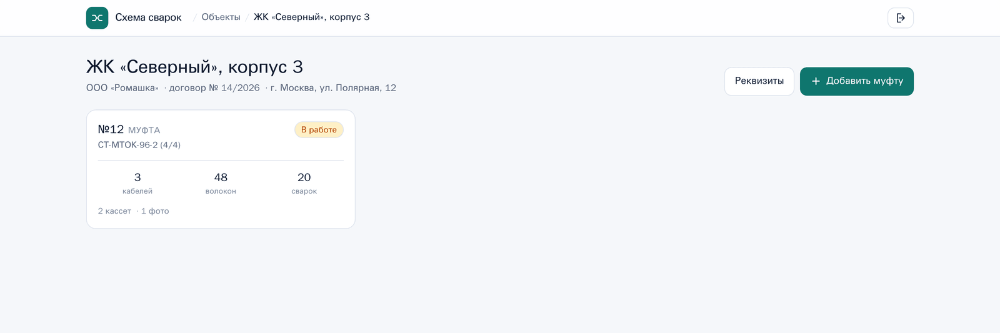
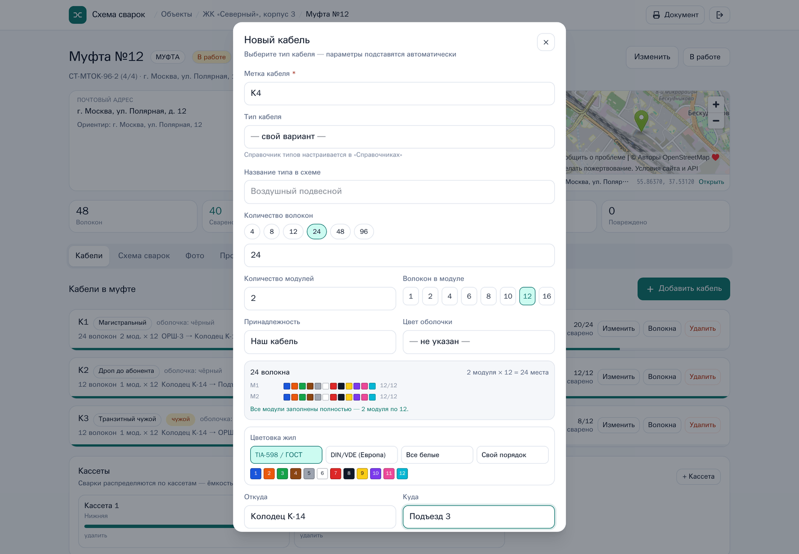
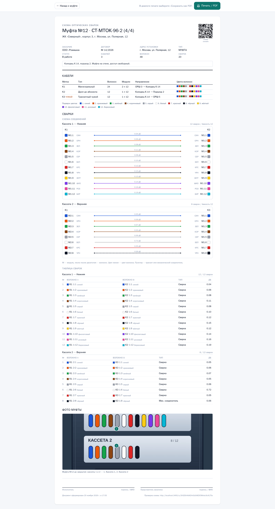

<div align="center">

# 🔌 Схема сварок

**Учёт оптических сварок в муфтах: схема, фото и документ для заказчика**

Сварщик вносит кабели и волокна, собирает схему в два касания, прикладывает фото
муфты — и отдаёт заказчику печатный документ, PDF или ссылку только для чтения.

[](LICENSE)
[](https://nextjs.org)
[](https://www.postgresql.org)

</div>


---

## 📖 Содержание

- [Возможности](#-возможности)
- [Как это работает](#-как-это-работает)
- [Скриншоты](#-скриншоты)
- [Установка](#-установка)
- [Деплой](#-деплой)
- [Проверки](#-проверки)
- [Структура](#-структура)
- [Модель данных](#-модель-данных-два-решения-которые-важно-не-менять)
- [Безопасность](#-безопасность)
- [Что дальше](#-что-дальше)
- [Лицензия](#-лицензия)

## ✨ Возможности

### 📐 Схема и данные

- **Объекты → муфты → кабели → волокна.** Волокна генерируются по ёмкости кабеля,
  цвета — по TIA-598 (12 цветов), с модулями по 1/2/4/6/8/10/12/16 волокон.
- **Редактор сварок в два касания:** выбрали волокно в одном кабеле, затем во втором —
  сварка создана. Есть прямая автосварка, undo, привязка к кассете, тип соединения
  и затухание.
- **Кассеты** с контролем ёмкости: переполнение видно сразу.
- **Валидатор:** двойные сварки, дубли адресов, переполнение кассеты, превышение
  затухания, статусы без сварки.

### 🎨 Цвета и раскладка

- **Цветовка жил:** TIA-598/ГОСТ, DIN/VDE, «все белые» или свой порядок цветов
  с редактором по каждой жиле.
- **Вторая дюжина «с полосой» (13–24)** — чтобы различать волокна в 24-волоконных модулях.
- **Предпросмотр раскладки до сохранения:** заполнение каждого модуля, остаток
  и количество свободных позиций. Ошибка «не помещается» показывается до сохранения.
- **Смена цвета жилы при сварке:** тап по волокну → «Изменить цвет жилы». Работает
  и для уже сваренного волокна.

### 📄 Документ и передача заказчику

- **Документ A4:** титул, легенда кабелей, таблицы сварок по кассетам, фото с метками,
  схема соединений, подписи сторон, QR на онлайн-схему. Печать и «Сохранить как PDF»
  из одного шаблона.
- **Публичная ссылка** с токеном, сроком действия, отзывом и счётчиком просмотров.
  Файлы по ссылке отдаются только для той муфты, на которую она выдана.

### 📷 Фото и адрес

- **Фото муфты:** загрузка с камеры телефона, сжатие на сервере, подписи и метки-пины
  на кассетах.
- **Адрес и карта:** почтовый адрес, координаты вручную или по адресу через Nominatim,
  карта OpenStreetMap. Грузится только по нажатию — без ключей API.

### ⚙️ Эксплуатация

- **Один пользователь**, вход по паролю, httpOnly-кука с HMAC-подписью.
- **Мобильный режим:** масштабирование заблокировано, поля 16px — iOS не увеличивает
  страницу при вводе.
- **Автономность:** PostgreSQL, Next.js и локальный каталог для фото. Никаких внешних
  сервисов, аккаунтов и API-ключей.

> Цвет волокна всегда дублируется номером и подписью — инструмент остаётся рабочим
> для дальтоников и при чёрно-белой печати.

## 🧭 Как это работает

1. **Объект.** Название, заказчик, адрес, договор — верхний уровень учёта.
2. **Муфта.** Номер, модель, статус, адрес и координаты. Внутри — кассеты и кабели.
3. **Кабель.** Метка, тип (с пресетом параметров), число волокон и модулей,
   направление «откуда → куда», принадлежность (наш или транзитный).
4. **Сварка.** Два нажатия по волокнам — и ребро готово. Волокна получают статус
   «сварено», кассета — заполнение.
5. **Проверка.** Валидатор подсвечивает двойные сварки, переполнение кассеты,
   завышенное затухание и кабели без сварок.
6. **Передача.** Документ A4 с QR или публичная ссылка — заказчик открывает схему
   без пароля и видит ровно ту муфту, на которую она выдана.

## 📸 Скриншоты

<table>
<tr>
<td width="50%">

**Объекты: сколько муфт, волокон и сварок**


</td>
<td width="50%">

**Объект → его муфты**



</td>
</tr>
</table>

**Карточка муфты** — адрес и карта, статистика волокон, кабели и кассеты:

[](docs/screenshots/03-closure-cables.png)

<table>
<tr>
<td width="50%">

**Новый кабель: предпросмотр раскладки**



</td>
<td width="50%">

**Редактор сварок**


</td>
</tr>
<tr>
<td width="50%">

**Валидатор: замечания и ошибки**


</td>
<td width="50%">

**Фото муфты с метками кассет**


</td>
</tr>
<tr>
<td width="50%">

**Публичная ссылка для заказчика**


</td>
<td width="50%">

**Справочники: палитра и типы кабелей**


</td>
</tr>
</table>

**Документ A4** — печать и PDF из одного шаблона:

[](docs/screenshots/10-document.png)

**Публичная страница** без пароля, только чтение:

[](docs/screenshots/12-public.png)

<div align="center">


*Та же схема на телефоне — компактная компоновка*

</div>

## 🚀 Установка

Нужны **Node.js 20+** и **PostgreSQL 14+** (или Docker — для базы он поднимается
одной командой).

```bash
git clone https://github.com/yolo-spolo/fiber-splice-scheme.git
cd fiber-splice-scheme
npm install
cp .env.example .env
```

### 🔑 Заполните `.env`

В репозитории **нет** готового `.env` — только шаблон `.env.example`. Приложение
не запустится с пустыми или демонстрационными значениями, поэтому секреты нужно
подставить свои. Файл `.env` перечислен в `.gitignore` и в репозиторий не попадёт.

| Переменная | Обязательна | Что указать |
|---|:---:|---|
| `DATABASE_URL` | ✅ | строка подключения PostgreSQL |
| `AUTH_PASSWORD` | ✅ | пароль единственного пользователя |
| `AUTH_SECRET` | ✅ | ключ подписи сессионной куки |
| `APP_URL` | ✅ | внешний адрес приложения |
| `UPLOAD_DIR` | — | каталог для фото, по умолчанию `./data/uploads` |

**`AUTH_SECRET`** — сгенерируйте случайный ключ, не придумывайте вручную:

```bash
openssl rand -hex 32
```

> [!IMPORTANT]
> Без `AUTH_SECRET` приложение отвечает **503 на всех страницах**: middleware
> не выпускает сессии с неопределённым секретом.

**`AUTH_PASSWORD`** — придумайте свой пароль. Он же используется E2E-скриптами.

**`APP_URL`** — адрес, по которому открывается приложение. От схемы зависит флаг
`Secure` у сессионной куки: с `https://` кука передаётся только по TLS, с `http://`
работает и на локальном порту.

> [!WARNING]
> Если указать `https://` для HTTP-адреса, браузер молча выбросит куку и после
> входа снова покажет пароль.

Проверить заполнение до запуска:

```bash
npm run setup:check
```

Скрипт не печатает значения секретов — только имена переменных, которые осталось
заполнить.

### 🗄️ База и первый запуск

```bash
docker compose up -d          # PostgreSQL на localhost:5433
npx prisma db push            # схема
npm run db:seed               # демо-объект и муфта (необязательно)
npm run dev
```

Откройте **http://localhost:3000** и войдите паролем из `AUTH_PASSWORD`.

Сид пропускается, если в базе уже есть объекты, — его можно запускать повторно.

<details>
<summary>📦 Демо-данные и скриншоты</summary>

```bash
npm run demo:data    # объект, муфта, 3 кабеля, 20 сварок, фото с метками, публичная ссылка
npm run screenshots  # PNG в docs/screenshots (нужен запущенный сервер)
```

`demo:data` идемпотентна: если объект уже есть, ничего не меняется. Скриншоты
требуют `AUTH_PASSWORD`; адрес берётся из `BASE_URL`.

```bash
AUTH_PASSWORD='ваш-пароль' npm run screenshots
```

</details>

## 🐳 Деплой

### Docker Compose + HTTPS

Готовый комплект с Caddy: он сам получает TLS-сертификат, база и фото лежат в томах
и переживают пересборку.

```bash
cd deploy
cp .env.example .env    # DOMAIN, APP_URL, DB_PASSWORD, AUTH_PASSWORD, AUTH_SECRET
docker compose up -d --build
```

`deploy/.env` в репозиторий не попадает. Переменные с `:?` в
`deploy/docker-compose.yml` обязательны: без них контейнер не запустится, так что
забыть пароль или секрет не получится. Миграции применяются автоматически при
старте контейнера (`prisma db push`).

### Systemd без Docker

Если приложение уже собрано (`npm run build`) и PostgreSQL доступен с хоста:

```bash
sudo useradd --system --home /opt/fiber-splice-scheme --shell /usr/sbin/nologin fiber
sudo cp -r . /opt/fiber-splice-scheme
sudo chown -R fiber:fiber /opt/fiber-splice-scheme
sudo cp deploy/fiber.service /etc/systemd/system/fiber.service
sudo systemctl daemon-reload
sudo systemctl enable --now fiber
sudo ufw allow 3000/tcp
```

Служба читает `/opt/fiber-splice-scheme/.env`. Пути и порт при необходимости
поправьте в `deploy/fiber.service`, логи — `/var/log/fiber.log`.

### Обновление и резервные копии

```bash
git pull && cd deploy && docker compose up -d --build
```

Для резервной копии достаточно двух томов:

```bash
docker run --rm -v deploy_pgdata:/data -v "$PWD":/backup alpine \
  tar czf /backup/pg-$(date +%F).tgz -C /data .
docker run --rm -v deploy_uploads:/data -v "$PWD":/backup alpine \
  tar czf /backup/uploads-$(date +%F).tgz -C /data .
```

## ✅ Проверки

```bash
npm test                      # валидатор, раскладка, цвета (vitest)
npm run build                 # типы + сборка
node e2e/flow.mjs             # объект → муфта → кабели → сварка → документ
node e2e/cold-start.mjs       # создание с нуля, дубль номера, ручная сварка
node e2e/share.mjs            # фото, метки, публичная ссылка, доступ к файлам
```

E2E-скрипты берут адрес из `BASE_URL` (по умолчанию `http://localhost:3000`),
пароль — из `AUTH_PASSWORD`, каталог скриншотов — из `SHOTS_DIR`. Пароль и адрес
в коде не зашиты:

```bash
npx playwright install chromium        # один раз
AUTH_PASSWORD='ваш-пароль' node e2e/flow.mjs
```

Подробности — в [`e2e/README.md`](e2e/README.md).

## 🗂 Структура

```
src/app/                 маршруты (App Router)
  closures/[id]/(detail) карточка муфты: кабели, сварки, фото, проверка, ссылка
  closures/[id]/print    документ A4
  s/[token]              публичная схема и её файлы
src/lib/actions/         серверные экшены (валидация Zod на границе)
src/lib/validate.ts      правила схемы, покрыты юнит-тестами
src/components/document  шаблон документа для печати и публичной страницы
prisma/schema.prisma     модель данных
scripts/                 проверка .env, демо-данные, скриншоты
deploy/                  Docker Compose, Caddy, unit для systemd
docs/screenshots/        снимки экранов для README
```

## 🧠 Модель данных: два решения, которые важно не менять

1. **Волокно адресуется триадой «кабель → модуль → позиция»**, а не сквозным номером.
   Иначе 48- и 96-волоконные кабели превращаются в кашу при перекладке модулей.
2. **Сварка — это ребро между двумя волокнами**, а не запись в журнале. Транзит,
   пигтейлы, переварки и сплиттеры (через `Splitter` + `groupId`) получаются
   из этой же модели без отдельных таблиц.

## 🔒 Безопасность

- Секреты живут только в `.env` (локально) и `deploy/.env` (Docker); оба файла
  в `.gitignore`. В репозитории есть лишь шаблоны с заведомо нерабочими значениями.
- Сессия — httpOnly-кука с HMAC-подписью и сроком 30 дней. Смена `AUTH_SECRET`
  разлогинивает все устройства.
- Публичная ссылка — отдельный токен со сроком действия и отзывом; файлы по ней
  отдаются только для своей муфты.
- Приложение рассчитано на одного пользователя и развёртывание под своим контролем:
  нет регистрации, ролей и внешней аутентификации.

## 🗺 Что дальше

- 📴 Офлайн-режим (PWA): запись в IndexedDB и досылка при появлении связи.
- 🕓 Версии схемы «как было / как стало» для переварок и сдачи объекта.
- 📑 Шаблоны типовых муфт и клонирование.
- 📊 Импорт кабельного журнала из Excel, наряд-задание и акт из тех же данных.
- 🧰 Учёт материалов: кассеты, гильзы, пигтейлы, сплиттеры.

## 📄 Лицензия

[MIT](LICENSE) — используйте, меняйте и распространяйте свободно.
